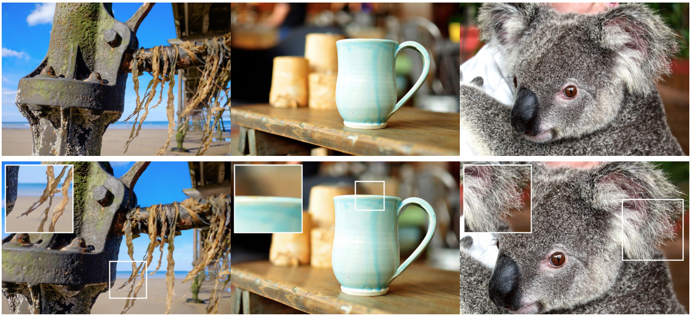

# Sharp Monocular View Synthesis in Less Than a Second

[](https://apple.github.io/ml-sharp/)
[](https://arxiv.org/abs/2512.10685)

This software project accompanies the research paper: _Sharp Monocular View Synthesis in Less Than a Second_
by _Lars Mescheder, Wei Dong, Shiwei Li, Xuyang Bai, Marcel Santos, Peiyun Hu, Bruno Lecouat, Mingmin Zhen, Amaël Delaunoy,
Tian Fang, Yanghai Tsin, Stephan Richter and Vladlen Koltun_.



We present SHARP, an approach to photorealistic view synthesis from a single image. Given a single photograph, SHARP regresses the parameters of a 3D Gaussian representation of the depicted scene. This is done in less than a second on a standard GPU via a single feedforward pass through a neural network. The 3D Gaussian representation produced by SHARP can then be rendered in real time, yielding high-resolution photorealistic images for nearby views. The representation is metric, with absolute scale, supporting metric camera movements. Experimental results demonstrate that SHARP delivers robust zero-shot generalization across datasets. It sets a new state of the art on multiple datasets, reducing LPIPS by 25–34% and DISTS by 21–43% versus the best prior model, while lowering the synthesis time by three orders of magnitude.

## Getting started

We recommend creating a Python environment first:

```bash
conda create -n sharp python=3.13
conda activate sharp
```

Install the package:

```bash
pip install -e .
```

For video trajectory rendering (requires a CUDA GPU), install the render extras:

```bash
pip install -e ".[render]"
```

To test the installation:

```bash
sharp --help
```

## Web Viewer

This repository includes a local web app for uploading a single image and viewing the generated 3D Gaussian Splat in the browser.

From the `ml-sharp/` directory:

```bash
uvicorn web.server:app --host 127.0.0.1 --port 8000
```

Open [http://127.0.0.1:8000](http://127.0.0.1:8000), upload an image, and wait for processing to complete. Results are rendered in-browser using Three.js and Gaussian Splats 3D.

Notes:
- Prediction works on CPU, CUDA, and MPS.
- Video rendering is still CUDA-only and requires the `[render]` extras.
- Job data is written to `web/jobs/` (transient; cleaned on server startup).

## Using the CLI

To run prediction:

```bash
sharp predict -i /path/to/input/images -o /path/to/output/gaussians
```

The model checkpoint will be downloaded automatically on first run and cached locally at `~/.cache/torch/hub/checkpoints/`.

Alternatively, you can download the model directly:

```bash
wget https://ml-site.cdn-apple.com/models/sharp/sharp_2572gikvuh.pt
```

To use a manually downloaded checkpoint, specify it with the `-c` flag:

```bash
sharp predict -i /path/to/input/images -o /path/to/output/gaussians -c sharp_2572gikvuh.pt
```

The results will be 3D gaussian splats (3DGS) in the output folder. The 3DGS `.ply` files are compatible with various public 3DGS renderers. We follow the OpenCV coordinate convention (x right, y down, z forward). The 3DGS scene center is roughly at (0, 0, +z). When dealing with 3rdparty renderers, please scale and rotate to re-center the scene accordingly.

### Rendering trajectories (CUDA GPU only)

Additionally you can render videos with a camera trajectory. While the gaussians prediction works for all CPU, CUDA, and MPS, rendering videos via the `--render` option currently requires a CUDA GPU. The gsplat renderer takes a while to initialize at the first launch.

```bash
sharp predict -i /path/to/input/images -o /path/to/output/gaussians --render

# Or from the intermediate gaussians:
sharp render -i /path/to/output/gaussians -o /path/to/output/renderings
```

## Windows App

A self-contained Windows onedir build is available under `sharp-app/`. 

To build it:

```powershell
.\sharp-app\build.ps1
```

The build will stage web assets, run PyInstaller, and copy the model checkpoint from `~/.cache/torch/hub/checkpoints/` to `sharp-app/dist/ml-sharp/model/`. After building, run `ml-sharp.exe` and open [http://127.0.0.1:8000](http://127.0.0.1:8000).

## Development

Run smoke tests from the repo root:

```bash
python tests/test_smoke.py
```

Notes:
- `gsplat` and `imageio[ffmpeg]` are only required for rendering (`[render]` extra). The core inference path runs without them.
- The web server imports the shared inference pipeline from `sharp.cli.predict` and is safe to run in environments without CUDA/gsplat.

## Evaluation

Please refer to the paper for both quantitative and qualitative evaluations.
Additionally, please check out this [qualitative examples page](https://apple.github.io/ml-sharp/) containing several video comparisons against related work.

## Citation

If you find our work useful, please cite the following paper:

```bibtex
@inproceedings{Sharp2025:arxiv,
  title      = {Sharp Monocular View Synthesis in Less Than a Second},
  author     = {Lars Mescheder and Wei Dong and Shiwei Li and Xuyang Bai and Marcel Santos and Peiyun Hu and Bruno Lecouat and Mingmin Zhen and Ama\"{e}l Delaunoy and Tian Fang and Yanghai Tsin and Stephan R. Richter and Vladlen Koltun},
  journal    = {arXiv preprint arXiv:2512.10685},
  year       = {2025},
  url        = {https://arxiv.org/abs/2512.10685},
}
```

## Acknowledgements

Our codebase is built using multiple opensource contributions, please see [ACKNOWLEDGEMENTS](ACKNOWLEDGEMENTS) for more details.

## License

Please check out the repository [LICENSE](LICENSE) before using the provided code and
[LICENSE_MODEL](LICENSE_MODEL) for the released models.
